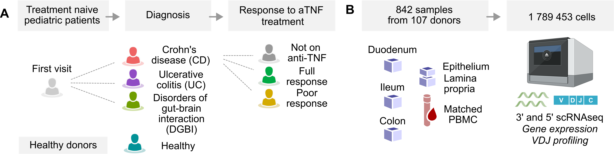

# Analysis of scRNAseq data from T cells in the PREDICT study

The manuscript is currently published as a preprint:

* [Local and circulating cytotoxic CD4⁺ T cells are early markers of disease activity in pediatric Crohn’s disease](https://www.medrxiv.org/content/10.64898/2026.06.16.26354238v1)

Please see also our related work:

* [Concerted changes in the pediatric single-cell intestinal ecosystem before and after anti-TNF blockade, eLife, 2023](https://elifesciences.org/reviewed-preprints/91792#tab-content)
* [Divergent T Cell Phenotypes Define Pediatric Crohn’s Disease and Ulcerative Colitis, medRxiv, 2025](https://www.medrxiv.org/content/10.1101/2025.10.16.25336112v1)

This repository contains the analysis scripts, computational notebooks, and supporting data files associated with the study "Local and circulating cytotoxic CD4 T cells are early markers of disease activity in pediatric Crohn’s disease."

The study investigates cytotoxic CD4 T cells (CD4 CTLs) in intestinal tissues and peripheral blood from pediatric patients with Crohn’s disease (CD), ulcerative colitis (UC), and disorders of gut–brain interaction (DGBI), as well as healthy donors. The analyses focus on the identification and characterization of CD4 CTLs, their association with disease activity and response to anti-TNF treatment, and potential mechanisms regulating their differentiation.

## Repository structure

The repository contains R and Python scripts, Jupyter notebooks, and R Markdown files organized into the following directories:

* 01_Cohort_characteristics — Analysis of clinical cohort characteristics, disease distribution, and laboratory parameters.

* 02_Gut_all_cells — Processing, annotation, and differential gene expression analyses of intestinal single-cell RNA sequencing (scRNA-seq) datasets.

* 03_Gut_CD4 — Characterization of intestinal CD4 T-cell populations, including CD4 CTL frequencies, compositional analysis, differentiation trajectories, transcription factor analysis, and T-cell receptor (TCR) analyses.

* 04_Other_datasets — Reanalysis of independently published datasets for external validation and comparison.

* 05_Integrated_ILE_LP_atlas — Integration and annotation of ileal lamina propria scRNA-seq datasets, analysis of cellular associations, and inference of ligand–receptor interactions using NicheNet.

* 06_Bulk_deconvolution_RISK — Deconvolution of bulk RNA-seq data from the RISK cohort using single-cell reference profiles and BayesPrism.

* 07_Blood_all_cells — Analysis of peripheral blood scRNA-seq datasets, integration of blood and intestinal CD4 T cells, and TCR comparisons.

* 08_Sorted_CD4_CTL — Analysis of sorted CD4 CTL populations.

* 09_Flow_cytometry_data — Analysis of flow cytometry experiments.

## Supporting files and archived version

Supporting data and analysis output files are available through Zenodo, including differential gene expression results, cell population frequencies, clinical laboratory measurements, TCR analysis outputs, flow cytometry results, and sample metadata.

Zenodo archive — [DOI: 10.5281/zenodo.24266542](https://zenodo.org/records/24266542)

This GitHub repository contains the analysis code and may be updated independently of the archived Zenodo version. The Zenodo record provides a permanent snapshot of the code and supporting files associated with the revised manuscript.

## Data availability

The scRNA-seq data generated in this study have been deposited in the NCBI Gene Expression Omnibus (GEO) under accession number [GSE352630](https://www.ncbi.nlm.nih.gov/geo/query/acc.cgi?acc=GSE352630).

Interactive visualization of the datasets is available through the Broad Institute Single Cell Portal:

* [SCP3737](https://singlecell.broadinstitute.org/single_cell/study/SCP3737) — Peripheral blood datasets.
* [SCP3739](https://singlecell.broadinstitute.org/single_cell/study/SCP3739) — Intestinal T and NK cell datasets.
* [SCP3741](https://singlecell.broadinstitute.org/single_cell/study/SCP3741) — Intestinal CD4 T-cell datasets.
* [SCP3898](https://singlecell.broadinstitute.org/single_cell/study/SCP3898/local-and-circulating-cytotoxic-cd4-t-cells-are-early-markers-of-disease-activity-in-pediatric-crohns-disease-all-cells) — Integrated atlas of ileal lamina propria cell populations.

## Requirements

Running the code requires R version 4.2.1 or higher. Specific package versions may be required; please refer to the `sessionInfo()` output included in each notebook for details.

## Instructions

Clone the repository and download the processed datasets from the Broad Single Cell Portal links above. The notebooks can then be executed sequentially following the workflow described in the **Repository Structure** section.
